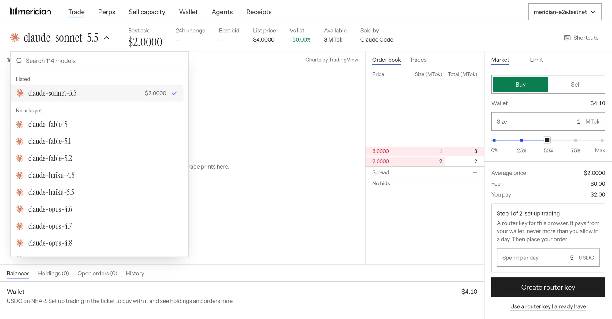
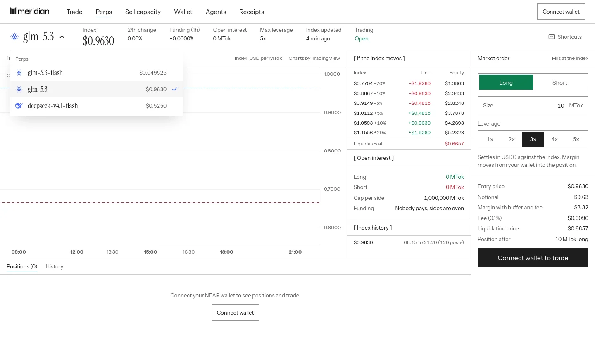
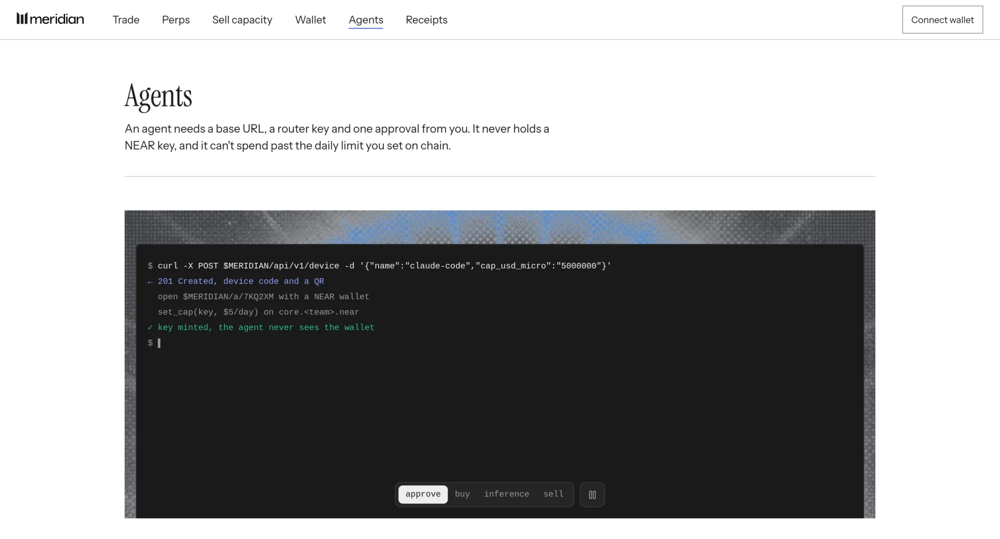
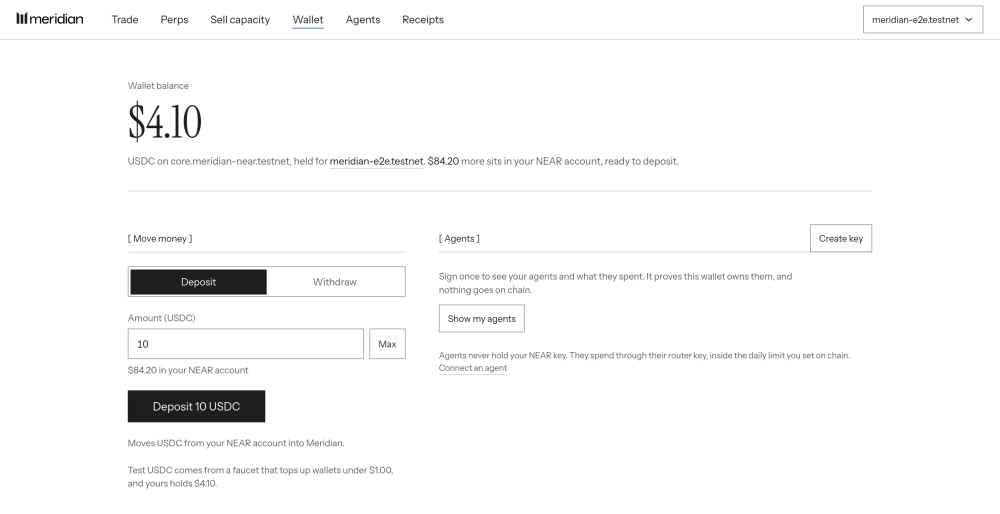
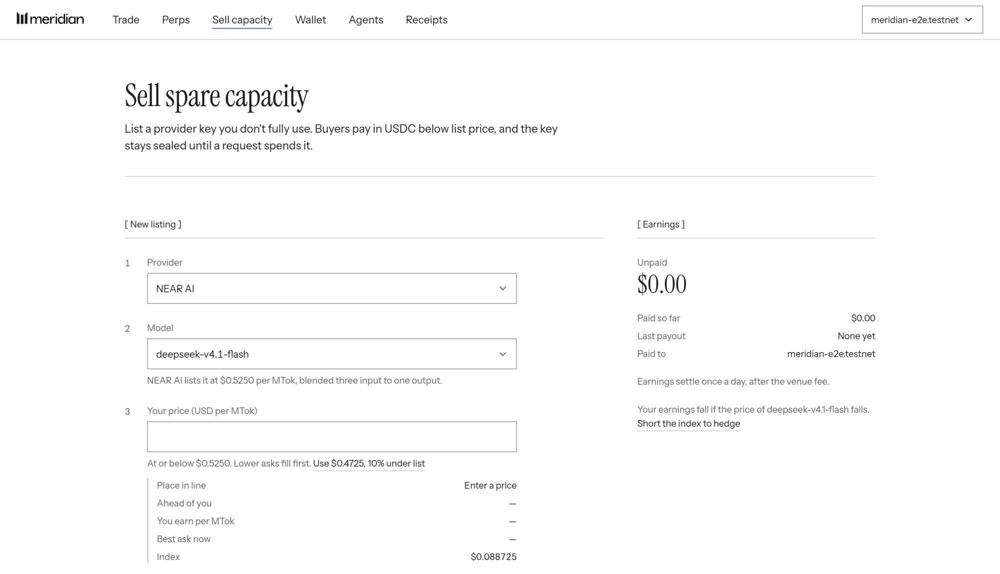
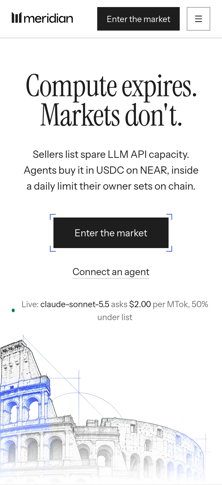
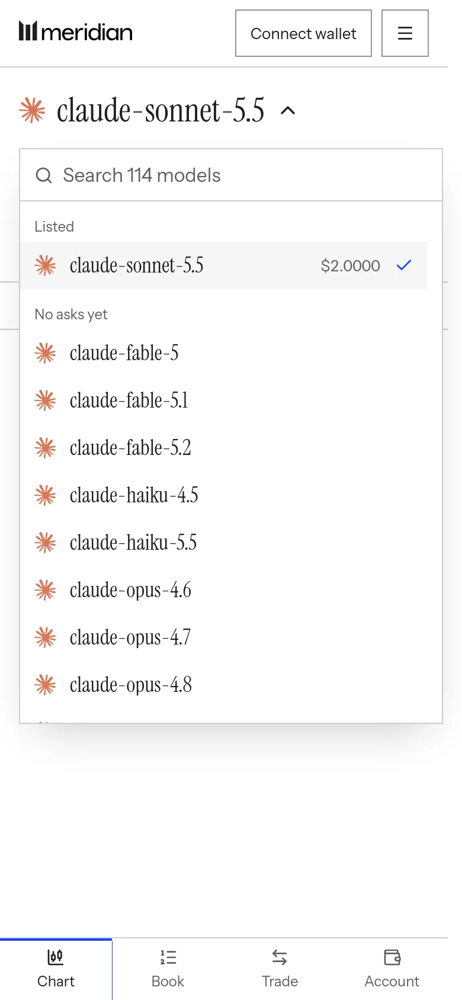
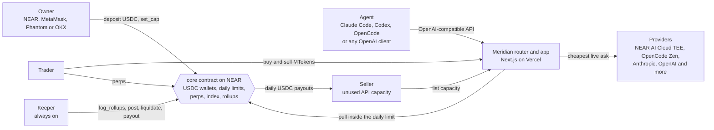
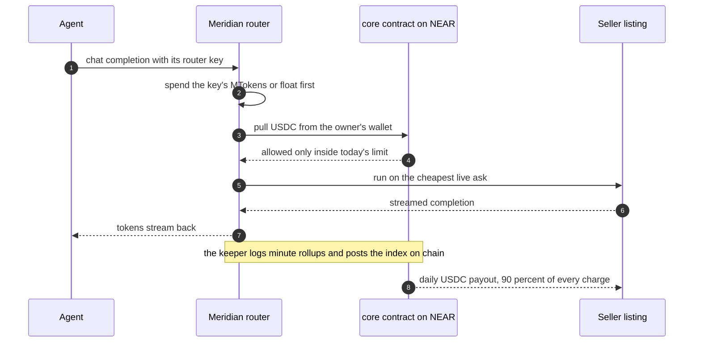

<p align="center">
  <a href="https://www.tradeonmeridian.xyz"></a>
</p>

<h1 align="center">Meridian</h1>

<p align="center">
  <b>The market for LLM capacity, settled in USDC on NEAR.</b><br>
  Sellers turn unused API capacity into USDC. Agents buy inference with a key of their own, inside a daily limit their owner sets on chain. Traders hedge the price with perps.
</p>

<p align="center">
  <a href="https://www.tradeonmeridian.xyz"></a>
  <a href="https://github.com/0xsoydev/meridian-near/actions/workflows/ci.yml"></a>
  <a href="https://testnet.nearblocks.io/address/core.meridian-near.testnet"></a>
  <a href="LICENSE"></a>
</p>

<p align="center">
  <a href="https://www.tradeonmeridian.xyz"><b>Open the app</b></a>
  &nbsp;&nbsp;|&nbsp;&nbsp;
  <a href="#try-it-in-60-seconds"><b>Try it in 60 seconds</b></a>
  &nbsp;&nbsp;|&nbsp;&nbsp;
  <a href="https://www.tradeonmeridian.xyz/skill.md"><b>Agent manual</b></a>
  &nbsp;&nbsp;|&nbsp;&nbsp;
  <a href="#why-near"><b>Why NEAR</b></a>
</p>

## In one minute

**The problem.** Teams that build with LLMs pay for capacity up front: API credits, monthly plans, committed spend. Some of it always goes unused and expires. At the same time, AI agents need to buy inference on their own, and nobody should hand an agent a credit card or a wallet key.

**Meridian is the market in between.**

- **Sellers** list capacity they won't use as MTokens (one MTok is a million tokens, blended three input to one output), at or below the provider's list price. They keep 90% of every charge, paid out in USDC every day.
- **Agents** buy inference through an OpenAI-compatible router that takes the cheapest live ask. They pay in USDC from their owner's wallet, and the `core` contract refuses anything past the daily limit the owner set. An agent never holds a NEAR key.
- **Traders** buy and resell MTokens on an order book, and go long or short a token-price index with USDC-settled perps at up to 5x.
- **Anyone can audit it.** Fills roll up on chain every minute, the index is posted on chain, and `/receipts` recomputes it in your browser.

All of it runs end to end on NEAR testnet today: a Rust contract, the router and trading app, an always-on keeper and an agent skill, across over 100 models from 8 providers.

## Try it in 60 seconds

The live app runs on NEAR testnet. Test USDC is free, and with MetaMask, Phantom or OKX you never need NEAR: you sign readable messages and Meridian pays the gas.

### In your browser

| | Do this | You see |
|---|---|---|
| 1 | Open **[tradeonmeridian.xyz](https://www.tradeonmeridian.xyz)** and choose **Enter the market**. | The trading terminal and the live order book. |
| 2 | Choose **Connect wallet**: a NEAR testnet wallet, MetaMask, Phantom or OKX. | Your account in the top right. |
| 3 | On **Wallet**, choose **Get 10 test USDC** and sign once. | "Added $10.00 test USDC to your wallet." |
| 4 | On **Trade**, pick a model under **Listed**. In **Step 1 of 2: set up trading**, set **Spend per day** and choose **Create router key**. | A router key for this browser that can never spend more than your daily limit. |
| 5 | Choose **Buy 1 MTok**. | Your fill under **Trades** and 1 MTok under **Holdings**. |
| 6 | On **Perps**, choose **Long** or **Short**, a size and a leverage from 1x to 5x. | Entry price, margin, fee and liquidation price before you sign, then your open position. |
| 7 | On **Agents**, copy the one-line prompt into Claude Code, Codex or OpenCode. | The agent shows a link and a QR code. Approve its daily limit from your phone and it buys inference on its own. |

### From a terminal, no wallet needed

For agents and AI reviewers: the live app issues demo keys at once. They spend from a shared house wallet under one daily limit.

```sh
export MERIDIAN=https://www.tradeonmeridian.xyz

# 1. The market: every model with a live ask, its price and its capacity
curl -s $MERIDIAN/api/v1/models | jq '.data[] | select(.best_ask_micro_per_mtok) | {id, best_ask_micro_per_mtok, reference_blended_micro_per_mtok, available_tokens}'

# 2. A demo key, issued at once
KEY=$(curl -sS -X POST $MERIDIAN/api/v1/device -H 'content-type: application/json' \
  -d '{"name":"trying meridian","demo":true}' | jq -r .key)

# 3. Inference, OpenAI-compatible. "cheapest:" routes to the cheapest live ask in the list
curl -sN $MERIDIAN/api/v1/chat/completions -H "authorization: Bearer $KEY" -H 'content-type: application/json' \
  -d '{"model":"cheapest:glm-5.3-flash,deepseek-v4.1-flash,glm-5.3,claude-sonnet-5.5","stream":true,"messages":[{"role":"user","content":"In one sentence, why should an agent pay in USDC?"}]}'

# 4. The receipt for that call: tokens, provider, charge and how it was paid
curl -s $MERIDIAN/api/v1/usage -H "authorization: Bearer $KEY" | jq '.data[0]'
```

Prices are micro-USD per MTok, sizes are tokens. Any OpenAI SDK works the same way: set `OPENAI_BASE_URL=$MERIDIAN/api/v1` and `OPENAI_API_KEY=$KEY`.

### Check it on chain

```sh
# A perps market read straight from the contract: index, open interest, max leverage
curl -s https://rpc.testnet.fastnear.com -H 'content-type: application/json' \
  -d '{"jsonrpc":"2.0","id":1,"method":"query","params":{"request_type":"call_function","finality":"final","account_id":"core.meridian-near.testnet","method_name":"market","args_base64":"eyJtb2RlbCI6ImdsbS01LjMifQ=="}}' \
  | jq -r '.result.result | implode'
```

`args_base64` is `{"model":"glm-5.3"}`. The same contract holds every wallet, limit and position: [`core.meridian-near.testnet` on NearBlocks](https://testnet.nearblocks.io/address/core.meridian-near.testnet).

## Product tour

### Trade



An order book for every model. The market picker searches the whole catalog, with each maker's logo and best ask. Market and limit orders, a live book and trade tape, TradingView candles and keyboard shortcuts. A first-time buyer sets up a router key with a daily limit right in the ticket.

### Perps



Go long or short the token-price index at up to 5x, margined and settled in USDC by `core`. Before you sign, the ticket shows entry price, notional, margin, the 0.1% fee and your liquidation price, and a ladder shows your PnL and equity at index moves from -20% to +20%.

### Agents, wallet, selling and phone

<table>
  <tr>
    <td width="50%" valign="top">
      <br>
      <b>Agents.</b> An agent needs a base URL, a router key and one approval. It never holds a NEAR key, and it can't spend past the limit you set on chain.
    </td>
    <td width="50%" valign="top">
      <br>
      <b>Wallet.</b> One USDC balance on <code>core</code>. Deposit, withdraw, create agent keys, see what each one spent today, raise a limit or revoke a key.
    </td>
  </tr>
  <tr>
    <td width="50%" valign="top">
      <br>
      <b>Sell capacity.</b> List a provider key in four steps: provider, model, price, capacity. The key stays sealed until a request spends it, and earnings settle daily in USDC.
    </td>
    <td width="50%" valign="top">
       <br>
      <b>On your phone.</b> Every page is built for small screens. The terminals switch to Chart, Book, Trade and Account tabs.
    </td>
  </tr>
</table>

### Receipts

`/receipts` reads the per-minute fill rollups and the posted index from `core` over public NEAR RPC, then recomputes the index in your browser with the keeper's own math. It lists NEAR AI response proofs, each checked against the signer from NEAR AI's TEE attestation, and every payout with its transaction.

## Who it's for

- **Teams with spare capacity.** A plan or credit balance you won't use this month becomes USDC. List it below list price, keep 90% of every charge, get paid daily.
- **Agent builders.** Give every agent its own key and its own daily budget, enforced on chain. See what each one spends, move unspent float back to your wallet, revoke in one step.
- **Heavy inference buyers.** Buy below list price from many providers through one OpenAI-compatible endpoint. Buy ahead when it's cheap and resell what you don't use.
- **Traders and hedgers.** A public price index for LLM tokens. Sellers short it to protect their earnings; buyers go long to lock in their costs.

## How it works



One inference request, end to end:



- **Money.** Owners deposit USDC into `core` and give each agent key a daily limit with `set_cap`. A request spends the key's prepaid MTokens first, then its float, and only then does the router `pull` from the owner's wallet, which `core` refuses past today's limit. When the limit is spent, the router answers 403 with an approval link and a QR code. Sellers' 90% is paid out daily by `payout`.
- **Price.** Every fill lands in a per-minute rollup that the keeper writes on chain with `log_rollups`. The index is the time-weighted average of the last hour's rollups, or the best ask when there were no fills, held between a tenth of list price and list price. The keeper posts it with `post`, at most once a minute and at most 10% per post.
- **Perps.** Positions live in `core`, margined and settled in USDC against the index, with hourly funding between longs and shorts and a cap on open interest per side. The keeper scans for underwater positions every minute and liquidates them.

## Why NEAR

Meridian needs three things from a chain: rules about money that no server can override, keys that can do exactly one job, and transactions cheap enough to publish a price every minute. NEAR has all three in the protocol.

| NEAR gives us | Meridian uses it to | So that |
|---|---|---|
| **Function-call access keys** | give the router a key that can only call `pull`, the keeper one that can only call `post`, `log_rollups`, `liquidate` and `payout`, and the relay one that only delivers signed orders | a leaked server key can't withdraw from any wallet: the protocol refuses the call |
| **The one-yoctoNEAR deposit guard** | require 1 yoctoNEAR on `withdraw`, `set_cap` and `modify` | only the owner's own wallet can move money out, raise a limit or trade, because a function-call key can't attach a deposit |
| **Contract-enforced state** | keep every USDC wallet, every agent's daily limit and every perps position in one Rust contract | an agent's ceiling is a rule on chain, not a setting on a server |
| **Named accounts and NEP-413** | have the account sign every listing, amendment, cancellation and key creation | the router only acts on what an account actually signed |
| **Native signature checks** (`ecrecover`, `ed25519_verify`) | let MetaMask, Phantom, OKX and any Ethereum or Solana wallet own a balance on `core` by address and sign readable orders that `core` verifies itself | people bring the wallet they already have, and Meridian relays and pays the gas |
| **Cheap, fast transactions** | write fill rollups on chain every minute and post the index as prices move | the price is public and anyone can recompute it |
| **USDC on NEAR** | settle every charge, payout and perp in USDC | prices and balances are in dollars, not a volatile token |
| **NEAR Intents 1Click** | quote deposits from and withdrawals to other chains in any token 1Click supports | money arrives from wherever people already hold it |
| **NEAR AI Cloud** | serve TEE-hosted models as a market rail, with signed responses | buyers get private inference and proof of the gateway that served it |

## Security model

Money moves only where its owner signed for it. Each key can do exactly this much:

| Key | Held by | Can | Cannot |
|---|---|---|---|
| The owner's NEAR key, or their Ethereum or Solana wallet | the owner | deposit, `withdraw`, set and raise limits (`set_cap`), trade perps (`modify`); a wallet owner does the last three by signing a message | |
| A router key `rk_` | an agent | run inference, buy and resell MTokens with its float, which refills by `pull` only inside the daily limit its owner set on chain | touch the wallet, raise its own limit, withdraw |
| A swarm key | one sub-agent | run inference with its share of a swarm's budget until the swarm ends | top up, trade, start a swarm, outlive `expires_at` |
| The web function-call key (`NEAR_WEB_KEY`) | the router | `pull` inside each owner's daily limit, into the treasury | `withdraw`, `set_cap`, `modify`, `payout` |
| The keeper function-call key (`NEAR_KEEPER_KEY`) | the keeper | `post` the index (one post a minute, 10% at most), `log_rollups`, `liquidate`, `payout` from the treasury | `withdraw` from a wallet, `set_cap`, `pull` |
| The relay function-call key (`NEAR_RELAY_KEY`) | the router | deliver a wallet owner's signed `set_cap_signed`, `withdraw_signed` or `modify_signed` | change, replay or forge one: `core` rebuilds the message and checks the owner's signature, nonce and expiry |

- **Limits live on chain.** `pull` refuses any amount past today's limit, so a runaway or compromised agent stops at its cap with a 403, whatever happens off chain.
- **Servers can't withdraw.** `withdraw`, `set_cap` and `modify` need one attached yoctoNEAR (`contracts/core/src/lib.rs`), which a function-call key can't attach.
- **Signatures are scoped and short-lived.** Signed messages name the site, the action and the time, and expire after five minutes. The router accepts a NEP-413 signature from a full-access key of the account, an Ethereum signature (EIP-191) whose recovered address is the account, or a Solana (ed25519) signature from the account's key (`lib/auth.ts`). Signed orders for `core` name the contract, a per-owner nonce and an expiry, and `core` verifies them itself: contract tests prove a signed limit can't be replayed, a signature only works for its owner, only covers what was signed, and is refused once expired.
- **Seller keys stay sealed.** Provider keys are encrypted at rest with AES-256-GCM, opened only on the server, and never shown to buyers.
- **The index resists manipulation.** It moves at most 10% a minute, stays between a tenth of list price and list price, and `core` refuses perps trades on an index older than ten minutes.
- **The worst case is bounded.** If both server keys leaked, an attacker could pull what is left of every owner's limit for today into the treasury and pay the treasury out. Owners would lose at most today's unused limits. No wallet can be emptied and no limit raised without its owner's signature.

## Designed to feel effortless

- **Any wallet, no gas.** One picker for NEAR wallets, MetaMask, Phantom, OKX and any Ethereum or Solana browser wallet. Ethereum and Solana owners sign readable messages ("Set a daily limit of 5 USDC for key …"), and Meridian relays them and pays the network fee.
- **Approve from your phone.** An agent shows a QR code. Scan it, approve the limit in your wallet, done.
- **Know before you sign.** Every ticket shows average price, fee and total. Perps add margin, liquidation price and a payoff ladder.
- **A real trading terminal.** A market picker with search and logos, a live order book and tape, TradingView candles, market and limit orders, keyboard shortcuts.
- **Fast by default.** The terminals are prerendered and served from Vercel's edge network, then fill in live data. Prices tick as they change.
- **Errors that explain themselves.** "The wallet didn't sign, so no test USDC was sent." A spent limit comes back with the link to raise it.
- **Phone and keyboard.** Phone layouts on every page, and the market picker is a full keyboard combobox.

## Built for agents

- **[`skill.md`](https://www.tradeonmeridian.xyz/skill.md)** is the manual, written for agents: every endpoint, field and error. Hand your agent one line: `Read https://www.tradeonmeridian.xyz/skill.md and get a Meridian router key.`
- **OpenAI-compatible.** `POST /api/v1/chat/completions`, streaming included. `model` takes any id from `/api/v1/models`, or `cheapest:a,b,c` to route to the cheapest live ask, and `X-Router-Model` names the pick.
- **The device flow.** `POST /api/v1/device` returns a link and a QR code for the human, and the agent polls until its key arrives. It never sees the wallet.
- **When a human is needed.** A request past today's limit answers 403 `approval_required`, one the wallet can't cover answers 402 `insufficient_balance`, each with `{ url, code, qr, near_cli, poll }`. The agent shows the QR, polls and retries.
- **Trading from code.** Buy, sell, rest bids and offers, read holdings and fills, read perps markets and accounts, all under `/api/v1`.
- **Swarms.** The [meridian-swarm skill](https://www.tradeonmeridian.xyz/skills/meridian-swarm/SKILL.md) runs one task on several models at once, each as its own OpenCode sub-agent in its own git worktree, with its own child key and share of the budget. You get a live table, one patch per model, and the unspent budget back.

```sh
curl -fsSL -O "$MERIDIAN/skills/meridian-swarm/SKILL.md" -O "$MERIDIAN/skills/meridian-swarm/swarm.ts"
MERIDIAN_URL=$MERIDIAN node swarm.ts 3 "fix the failing test" --budget 0.30
```

The first run asks for one approval through the device flow and keeps the key in `~/.config/meridian/key`. It needs Node 22.18 or newer, git and OpenCode.

## Hackathon tracks

Built for the NEAR Hackathon and submitted to seven tracks.

| Track | What Meridian brings | See it |
|---|---|---|
| Unstoppable DeFi (`defi`) | An order book for LLM capacity, a resale book, and USDC-settled perps on a token-price index posted on chain | `/trade`, `/perps` |
| Privacy & Private AI (`privacy`) | NEAR AI Cloud TEE models as a market rail, with signed responses checked against the attested signer; seller keys sealed at rest and never shown to buyers | `/receipts`, models with `verifiability: "tee"` |
| AI Swarms (`swarms`) | One task, several models at once: each an OpenCode sub-agent with its own key and share of one budget, the unspent part returned | the swarm skill, `POST /api/v1/swarm` |
| AI Security & Defense (`security`) | Daily limits enforced by `core`, agents that never hold a NEAR key, server keys that can't withdraw, signed orders with nonces and expiry | the security model above, `/wallet` |
| Agent Economy (`agents`) | Agents that buy their own inference in USDC, resell what they don't use and hedge with perps | `/skill.md`, `/agents` |
| Real-World Money (`realworld`) | Unused API spend turned into daily USDC payouts, and spend limits for agents like limits on a company card, from the wallet people already have | `/sell`, `/wallet` |
| Open Innovation (`open`) | LLM capacity as a tradable commodity, with a public index anyone can recompute | `/receipts` |

## Engineering

- **Contract.** Rust on `near-sdk` 5.30, with 21 unit tests: funding, limits that roll over at UTC midnight, `pull` inside the limit, payouts that pay once, withdrawals, perps that block on a stale index, rollups, and signed orders from Ethereum and Solana wallets.
- **App and router.** Next.js 16 and React 19, with 91 unit tests across auth, signatures, pricing, tickets, orders, perps, rollups, proofs, rails, sealing and cross-chain quotes.
- **CI** runs the typecheck, the unit tests, the production build and `cargo test` on every push to `develop` and every pull request.
- **Integer money.** Amounts are micro-USD and token counts, `bigint` in TypeScript and `u128` in Rust, end to end.
- **Database guarantees.** Postgres check constraints keep listings consistent: positive prices, capacity bounds, valid states.
- **Resilient RPC.** NEAR RPC calls fail over across providers on rate limits, timeouts and server errors.
- **Always-on keeper.** Rollups and resting-order matching every minute, index posts every three minutes, a liquidation scan every minute, payouts every day.

## Run it locally

Requires Node ≥ 22.22.2, pnpm 10, Rust 1.95 and `cargo-near`.

```sh
pnpm install
cp .env.example .env        # fill in DATABASE_URL, SECRETS_KEY, the NEAR ids and keys
pnpm --filter web db:generate && pnpm --filter web db:migrate
pnpm --filter web seed      # prints the owner's near commands
pnpm dev                    # http://localhost:3000
```

The keeper and the demo agent:

```sh
node --experimental-strip-types --env-file=apps/web/.env keeper/main.ts
pnpm --filter demo-agent start
```

The demo agent prints a link and a QR code; approve a daily limit and it streams an answer paid from your wallet. With `RUNAWAY=1 RK_KEY=<key>` it keeps buying until its limit stops it with a 403.

The contract:

```sh
cd contracts/core
cargo near build non-reproducible-wasm
near contract deploy <core.account> use-file target/near/meridian_core/meridian_core.wasm \
  with-init-call new json-args '{"owner":"<team>.near","ops":"ops.<team>.near","usdc":"<usdc>"}' \
  prepaid-gas '100 Tgas' attached-deposit '0 NEAR' network-config testnet sign-with-keychain send
```

USDC on NEAR mainnet is `17208628f84f5d6ad33f0da3bbbeb27ffcb398eac501a31bd6ad2011e36133a1`; on testnet Meridian uses `usdc.fakes.testnet`, which anyone can `mint`. `NEAR_NETWORK` selects the network. The step-by-step operations guide is [`docs/runbook.md`](docs/runbook.md) and the full specification is [`docs/plan.md`](docs/plan.md).

### Checks

```sh
pnpm typecheck
pnpm build
pnpm --filter web test
cd contracts/core && cargo test
```

## Repository layout

```
contracts/core/                          the Rust contract
apps/web/                                the router, the app and the API routes
apps/web/public/skill.md                 the manual agents read
apps/web/public/skills/meridian-swarm/   the swarm skill agents install
keeper/                                  rollups, index, liquidations, payouts
agents/demo/                             an agent that buys inference from the terminal
docs/plan.md                             the specification
docs/runbook.md                          deploy, seed, rehearse, recover
```

## Hackathon scope

Earlier work on other chains is imported at the tag `pre-hackathon`. Everything built for the NEAR Hackathon is the diff to the submitted tag: [`pre-hackathon...hackathon-submission`](https://github.com/0xsoydev/meridian-near/compare/pre-hackathon...hackathon-submission).

Built with AI coding assistants and reviewed by the team. Main libraries: `near-sdk` (Rust), Next.js, React, Tailwind CSS, Drizzle ORM with Postgres, `@hot-labs/near-connect`, `near-api-js`, `@noble/curves`, TradingView Lightweight Charts, Motion and Zod. Model logos come from LobeHub Icons (MIT). Released under the [MIT License](LICENSE).
